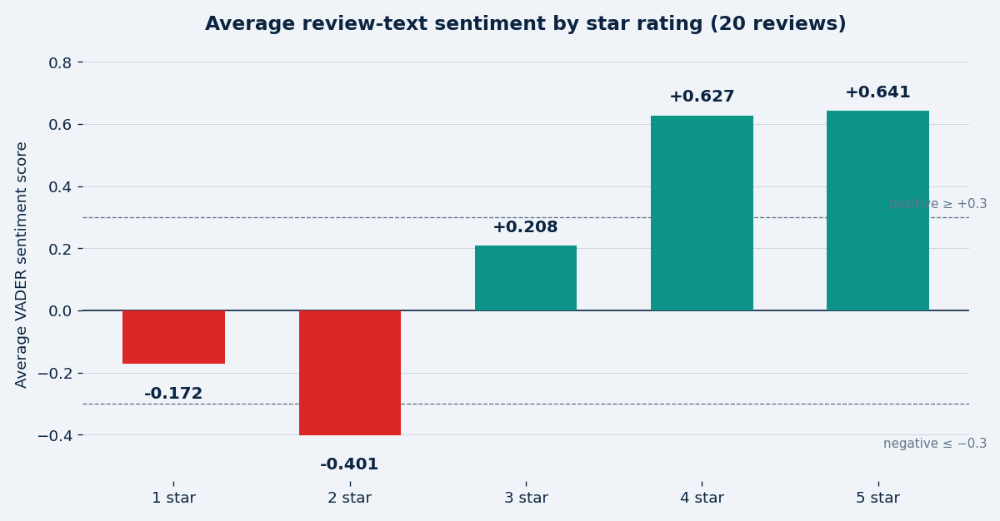

# Restaurant Review Sentiment vs Rating Mismatch

**Problem:** A star rating doesn't always match what the review text actually says. This project flags those mismatches — the same kind of check a review platform runs to catch fake or manipulated ratings, sarcasm, and rating-system confusion before rankings are built on them.

## Approach
1. Score each review's text with VADER sentiment analysis (`vaderSentiment`), giving a compound score from −1 to +1.
2. Convert the sentiment score into a 3-way label (positive / neutral / negative) using ±0.3 thresholds.
3. Convert the star rating into the same 3-way label (4–5★ positive, 3★ neutral, 1–2★ negative) so the two are directly comparable.
4. Flag every review where the text label and the star label disagree.
5. Sanity-check with average sentiment per star rating.

## The one number that matters
**5 of the 20 reviews (25%) have a sentiment/rating mismatch.**

The clearest case: a **1-star** review that reads *"Nothing went wrong here, it was a fine experience overall"* — its text sentiment is **+0.519 (positive)**. Either the star was a mistake, or the rating doesn't mean what it says.

All 5 flagged reviews:
| Rating | Text sentiment | Review |
|---|---|---|
| 3★ | positive (+0.557) | "It was okay, nothing special but not bad either." |
| 2★ | neutral (0.000) | "Overpriced for what you get. Would not come back." |
| 5★ | neutral (0.000) | "I was blown away by the quality and presentation." |
| 1★ | neutral (+0.103) | "Food was fine but I had to send it back once." |
| 1★ | positive (+0.519) | "Nothing went wrong here, it was a fine experience overall." |

## Average sentiment by star rating
| Stars | Avg sentiment |
|---|---|
| 1★ | −0.172 |
| 2★ | −0.401 |
| 3★ | +0.208 |
| 4★ | +0.627 |
| 5★ | +0.641 |



## Honest notes
- Sentiment rises with stars overall, but **2★ (−0.401) sits below 1★ (−0.172)** — with only 20 reviews, one strongly-worded review moves the average. On the full dataset this should smooth out.
- Not every flag is a fake rating. *"I was blown away by the quality…"* (5★) scored 0.000 because VADER doesn't recognise that idiom as positive — some mismatches are the sentiment tool's limits, not the reviewer's.
- The built-in data is a 20-review synthetic sample that mirrors the real dataset's structure.

## Using the real dataset
Dataset: [Google Maps Restaurant Reviews](https://www.kaggle.com/datasets/denizbilginn/google-maps-restaurant-reviews) (1,100 rows) on Kaggle. Download the CSV and replace the synthetic reviews block at the top of the script with:

```python
df = pd.read_csv("reviews.csv")[["text", "rating"]]
df.columns = ["review_text", "rating"]
```

Everything downstream runs unchanged.

## Run it
```bash
pip install pandas vaderSentiment
python projectB_review_sentiment.py
```
Prints the full scored table, the flagged mismatches, and average sentiment per star rating, and saves everything to `projectB_output_data.csv`.

## Try it at the user end — Streamlit app
`app.py` is the same logic as a user-facing checker: paste any review, pick the star rating it came with, press **Check this review**, and get the sentiment score, what the words say, what the stars say, and a MATCH / MISMATCH verdict instantly. It includes the built-in examples above (including the 1-star review that reads happy, and the 5-star "blown away" review the tool can't read).

```bash
pip install streamlit vaderSentiment
streamlit run app.py
```
Verified end-to-end: the happy 1-star review scores +0.519 → MISMATCH; the honest 5-star review scores +0.871 → MATCH; empty input asks for a review instead of crashing.
